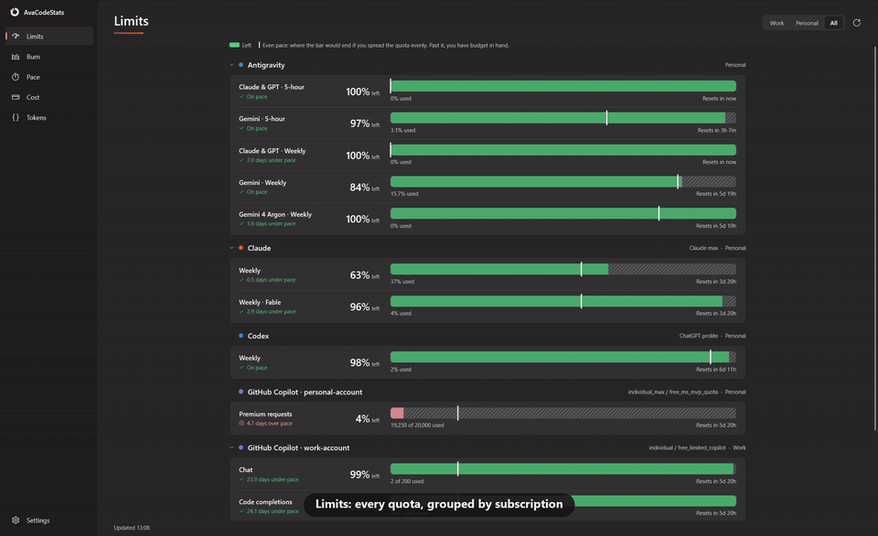
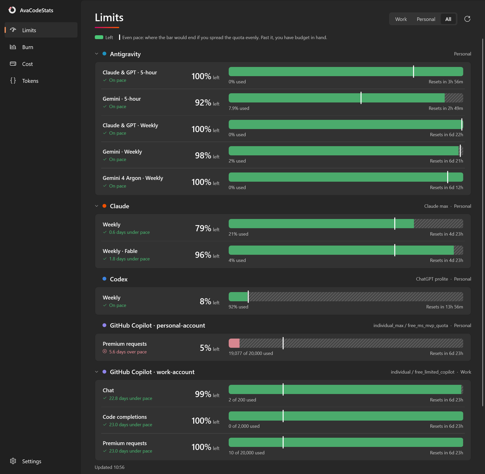
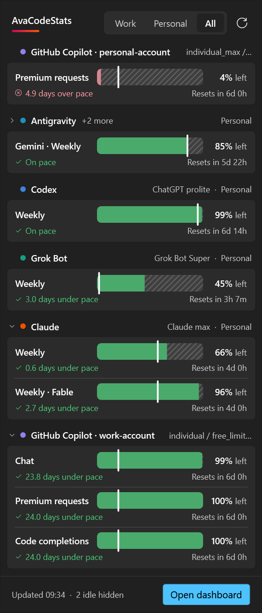
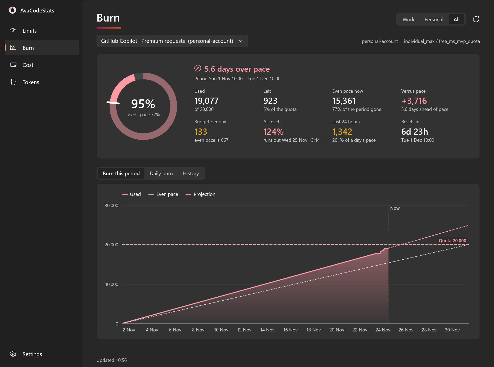
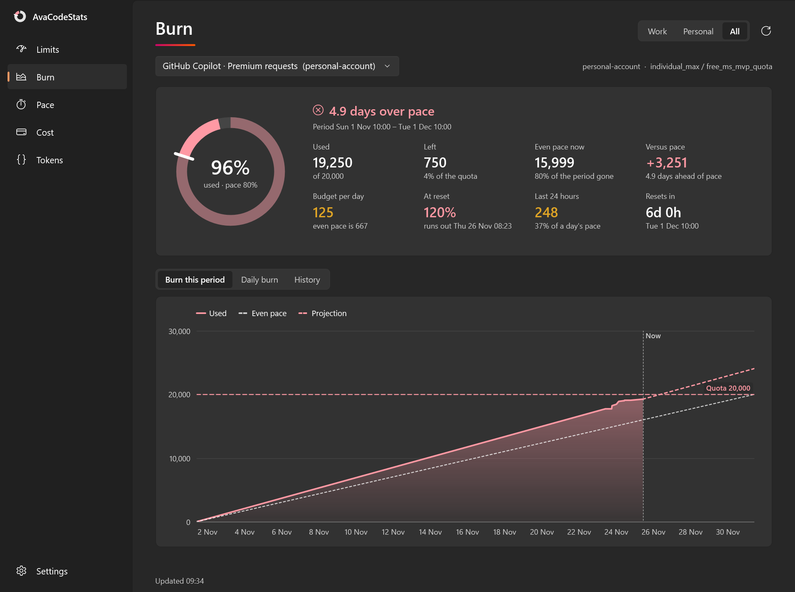
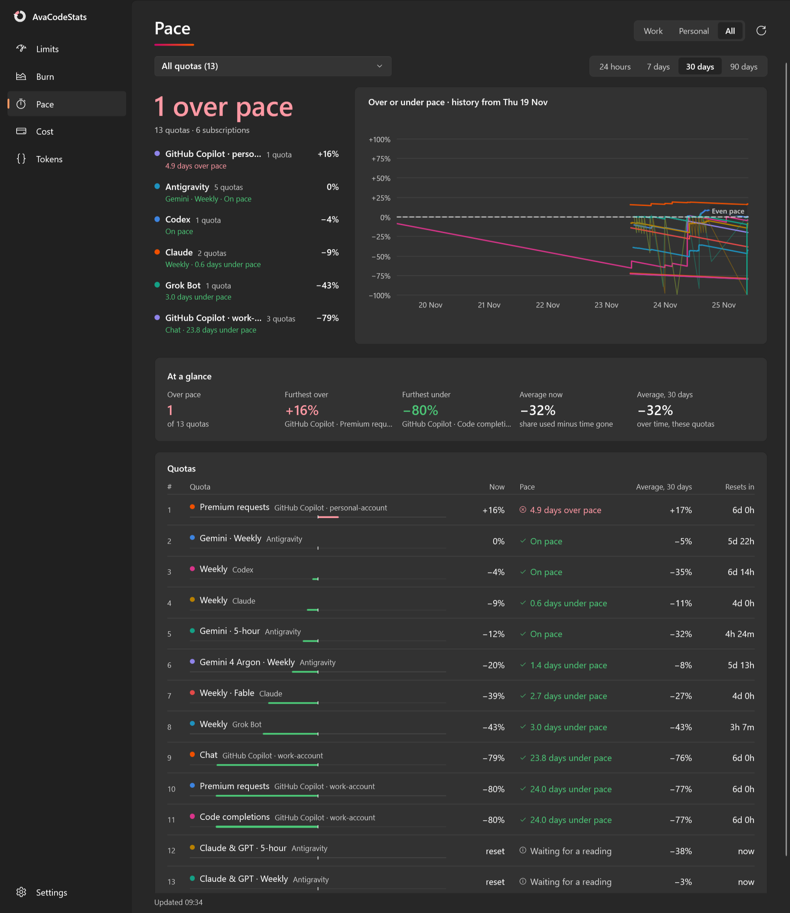
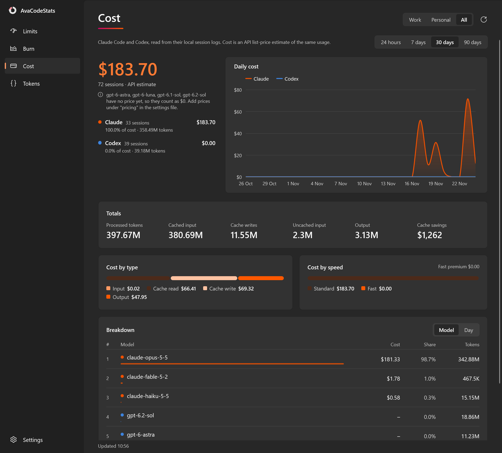
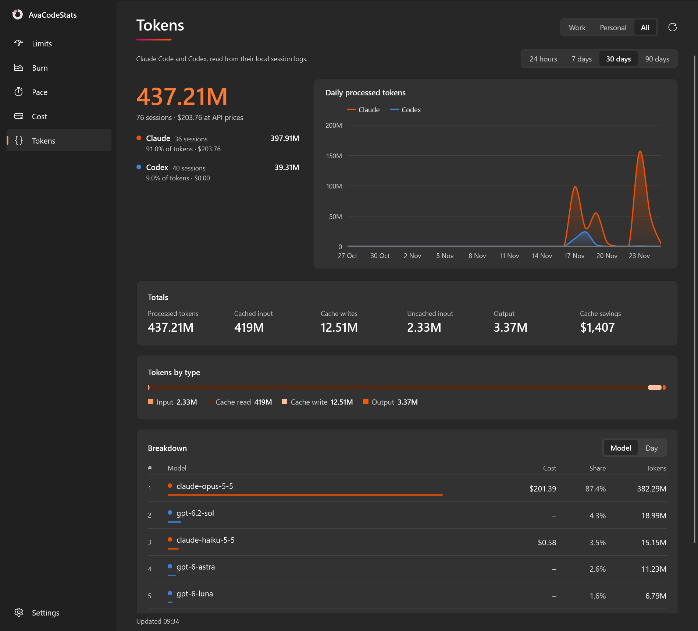
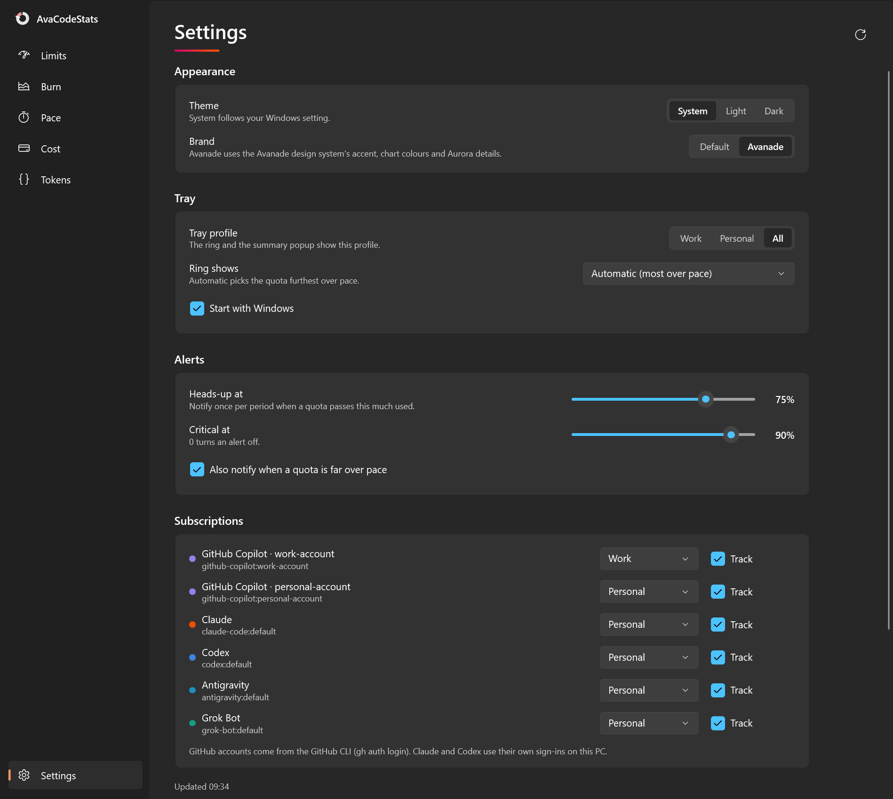

# AvaCodeStats

A Windows tray app that tracks AI coding subscriptions, shows whether you are burning them faster than an even pace, and keeps a history of usage, tokens and cost.

<a href="docs/tour.mp4"></a>

*33-second showcase ([full-quality MP4](docs/tour.mp4)).*

- **Tray ring**: the arc is how much of the quota is used. The notch is where an even pace would be today. The arc past the notch is overburn (amber or red); a faint stretch before it is budget in hand. It follows the **tray profile** (Work by default) and shows the quota furthest over pace, unless you pick one.
- **Click** the ring for the summary popup: the tray profile's quotas at a glance, with a profile switch. **Double-click** for the dashboard, **right-click** for the menu.
- **Alerts**: a notification once per period when a quota passes the heads-up (75%) and critical (90%) levels, and when it goes far over pace. Set the levels in Settings.
- **Dashboard** (WPF, Fluent theme with Mica; light, dark or system; Default or Avanade brand):
  - **Limits**: every quota as a bar. The fill shows what's left, the hatching shows what's used, and the tick shows where the fill would end at an even pace. Click a card to open its burn view.
  - **Burn**: every quota in the profile at once, one subscription's quotas, or one quota. Several quotas show how many are over pace, each quota's share used over 24 hours to 90 days, what runs out before its reset, and a table of every quota with its pace and burn in the range (click a row for its detail). One quota shows pace cards, the cumulative burn against the even-pace line with a projection, the daily burn against the daily allowance, and a history of earlier periods.
  - **Pace**: the same choice of quotas, as how far each one is over (+) or under (−) an even pace over time: the share used minus the share of the period gone, from −100% to +100%. Between readings the line falls as time passes, and it starts again from 0 at each reset. It also shows the quotas furthest over and under pace, the average now and over the range, and a table with a bar either side of even pace.
  - **Cost / Tokens**: Claude Code and Codex usage from their local session logs. It covers the past 24 hours, 7, 30 or 90 days, split by tool and model, plus cache savings and a breakdown by day. Cost is an API list-price estimate.
  - **Settings**: theme and brand, tray profile and quota, alert levels, which profile each subscription belongs to, polling interval.
- **Profiles**: Work, Personal, or All. The dashboard and the tray each have their own (switch at the top of the dashboard, in the popup, or in the tray menu).

## Screenshots

| Limits: every quota, grouped by subscription | Tray popup |
|---|---|
|  |  |

| Burn: all quotas, or one subscription's | Burn: one quota against an even pace |
|---|---|
|  |  |
| **Pace**: over (+) or under (−) an even pace, over time | **Cost**: API-price estimate from local session logs |
|  |  |
| **Tokens** | **Settings** |
|  |  |

Click a subscription's header to fold it to its most pressing quota (worst pace, then least left, then soonest reset), as Antigravity is in the popup above.

## What it reads

| Provider | Limits | Tokens / cost |
|---|---|---|
| GitHub Copilot | `api.github.com/copilot_internal/user`, the endpoint the Copilot extensions use for their own quota display. The token comes from the GitHub CLI (`gh auth token --user <login>`), so every `gh` account can be tracked. | – |
| Claude (Claude Code) | `api.anthropic.com/api/oauth/usage`, the endpoint behind Claude Code's `/usage`, using the sign-in Claude Code keeps in `~/.claude/.credentials.json`. It's read-only: the app never refreshes the token, so Claude Code's own login is untouched. | `~/.claude/projects/**/*.jsonl` |
| Codex | `chatgpt.com/backend-api/wham/usage` (Codex's own usage endpoint) with the ChatGPT sign-in Codex keeps in `~/.codex/auth.json`, read-only; falls back to the rate-limit windows in its session logs | `~/.codex/sessions`, `~/.codex/archived_sessions` |
| Antigravity | The Antigravity CLI: `agy -p "/quota" --output-format json` (answers without starting an agent turn or spending quota). Weekly and 5-hour limits per model group (Gemini, Claude & GPT, Gemini Argon). Read at most every 10 minutes. | – |
| Grok Bot | The weekly-usage cache the Grok Bot desktop app keeps in `%APPDATA%\Grok Bot\sand-client-persistence` (plain JSON; no credentials touched). As fresh as the app's last refresh, so open Grok Bot now and then. | – |

Snapshots are stored in SQLite every 5 minutes: changes always, unchanged readings at most hourly. Log files are read incrementally and their token events are copied into the database, so history survives the tools cleaning up their own logs.

Data lives in `%LOCALAPPDATA%\AvaCodeStats` (`settings.json`, `usage.db`). Set `AVACODESTATS_DATA` to use another folder.

## Settings

Most settings are in the dashboard's **Settings** page. Everything is also in `settings.json` (Settings > Open settings file, then Reload settings), including model prices:

```jsonc
{
  "pollMinutes": 5,
  "activeProfile": "work",              // dashboard: work | personal | unified
  "trayProfile": "work",                // tray ring and popup
  "themeMode": "system",                // system | light | dark
  "brand": "default",                   // default | avanade
  "warnAtPercent": 75,                  // 0 = off
  "criticalAtPercent": 90,
  "codexLiveUsage": true,
  "subscriptions": [
    { "provider": "github-copilot", "account": "jk-avanade", "profile": "work" },
    { "provider": "github-copilot", "account": "jernejk",    "profile": "personal" },
    { "provider": "claude-code",    "account": "default",    "profile": "personal" },   // "path": other Claude home
    { "provider": "codex",          "account": "default",    "profile": "personal" }    // "path": other CODEX_HOME
  ],
  "trayKeys": { "work": "github-copilot:jk-avanade:chat" },   // or pick from the tray menu
  "pricing": [                                              // USD per million tokens; longest prefix wins
    { "model": "gpt-6", "input": 0, "output": 0, "cacheRead": 0 }
  ],
  "onPaceDays": 0.5,     // within ±0.5 days of allowance = on pace
  "farOverDays": 2.0,    // more than 2 days of allowance over = red + notification
  "notifyWhenFarOverPace": true
}
```

Claude model prices are built in. Other vendors' models have no default price, so add them under `pricing` to include Codex in the cost view.

Pace is measured in **days of allowance**: one day of allowance is the quota divided by the days in the period. "4.6 days over pace" means you have used what an even pace would only reach 4.6 days from now.

## Adding a subscription type

Newly installed local tools (Claude Code, Codex, Antigravity CLI, Grok Bot) are added to the Personal profile on startup; move or switch them off in Settings.

Implement `IUsageProvider` in `src/AvaCodeStats.Core/Providers/<Name>/`. It returns `UsageSnapshot`s (used, entitlement, period) and can write `TokenEvent`s to the `TokenStore`. Then register it in `ProviderFactory`. Everything else (pace, history, tray, dashboard, profiles) is provider-agnostic.

## Build, run, install

```powershell
dotnet test
dotnet run --project src/AvaCodeStats -- --open limits   # also: burn | pace | cost | tokens
./scripts/install.ps1                                    # publishes to %LOCALAPPDATA%\Programs\AvaCodeStats and starts it
dotnet run --project src/AvaCodeStats -- --screenshots docs/screenshots   # regenerates the README screenshots
dotnet run --project src/AvaCodeStats -- --tour artifacts/tour            # renders the shots of the showcase video
uv run scripts/make-video.py artifacts/tour                               # builds docs/tour.mp4 and docs/tour.gif
```

`--screenshots` and `--tour` render every page and the popup from your recorded data, off screen, and exit. Account logins show as `work-account` / `personal-account`, nothing is polled and settings are not saved, so it can run next to the tray instance.

Then use **Start with Windows** in the tray menu.

The UI is WPF with the .NET Fluent theme; the Avanade brand uses tokens from the Avanade design system. Requires the .NET 10 desktop runtime, and the GitHub CLI for Copilot.
